# Arquitectura C4 - Consulta Vehicular · SRI y ANT

Sistema web que verifica en el SRI que un RUC pertenezca a un contribuyente persona natural, consulta su vehículo por placa y obtiene los puntos de su licencia en la ANT. Como la ANT tiene baja disponibilidad, cada respuesta correcta se guarda en una caché Redis en la nube y, si la ANT falla, se responde desde allí avisando que el dato no es reciente.

**Diseño y Arquitectura de Software · UDLA** · David Morales

## Arquitectura C4 (IcePanel)

- Nivel 1 · Contexto: https://s.icepanel.io/Dz3ZjrZimBwdlF/HGR7
- Nivel 2 · Contenedores: https://s.icepanel.io/Dz3ZjrZimBwdlF/7BWA
- Nivel 3 · Componentes: en IcePanel, dentro de cada contenedor (Web, ms-sri y ms-ant); cada componente enlaza a su archivo en GitHub.

| Contenedor | Tecnología | Responsabilidad |
|---|---|---|
| [`frontend`](frontend) | React 18 + Vite | Formulario por pasos: correo y RUC, placa, puntos y resumen |
| [`ms-sri`](ms-sri) | Java 17 · Spring Boot 3 | Valida RUC y placa; consulta contribuyente, persona natural y vehículo en el SRI |
| [`ms-ant`](ms-ant) | Java 17 · Spring Boot 3 · Jsoup | Consulta los puntos de la licencia en la ANT con caché y circuit breaker |
| Caché | Redis en la nube (Upstash) | Guarda el último dato bueno de la ANT |

## Contrato de la API

| Servicio | Método y ruta | Respuestas |
|---|---|---|
| ms-sri | `GET /api/v1/contribuyentes/{ruc}` | `200` · `400 RUC_INVALIDO` · `404 NO_ES_CONTRIBUYENTE` · `422 NO_ES_PERSONA_NATURAL` · `502 SRI_NO_DISPONIBLE` |
| ms-sri | `GET /api/v1/vehiculos/{placa}` | `200` · `400 PLACA_INVALIDA` · `404 VEHICULO_NO_ENCONTRADO` · `502 SRI_NO_DISPONIBLE` |
| ms-ant | `GET /api/v1/licencias/{cedula}/puntos?placa=&actualizar=` | `200` (`fuente`: `ANT`, `CACHE` o `CACHE_RESPALDO`) · `400 CEDULA_INVALIDA` · `503 ANT_NO_DISPONIBLE` |
| ms-ant | `GET` / `PUT /api/v1/simulacion/ant` | Consulta o activa la caída simulada de la ANT |

Las entradas se validan antes de llamar al SRI o a la ANT, y todos los errores tienen el mismo formato:

```json
{ "codigo": "RUC_INVALIDO", "mensaje": "El RUC ingresado no es válido.", "detalle": "El RUC debe tener 13 dígitos numéricos",
  "status": 400, "ruta": "/api/v1/contribuyentes/123", "fecha": "2026-11-17T20:39:55Z" }
```

## Caché y resiliencia

Patrón **Cache-Aside con respaldo** en `ms-ant`:

1. Dato guardado hace menos de **1 hora**: se responde desde Redis sin llamar a la ANT.
2. Si no, se consulta la ANT (timeout de 5 s) y cada respuesta correcta se guarda con un tiempo de vida de **7 días**.
3. Si la ANT falla, se responde con el último dato bueno, `esReciente: false` y un aviso con su fecha. Sin dato guardado: `503 ANT_NO_DISPONIBLE`.
4. Tras 3 fallos seguidos, no se llama a la ANT durante 60 s (circuit breaker).

**Por qué 1 hora y 7 días:** los puntos solo cambian con una citación nueva o un pago, así que un dato de menos de 1 hora es prácticamente actual y evita cargar un servicio frágil. Pasados 7 días el dato podría engañar al usuario, por eso Redis lo elimina. Las páginas de error de la ANT nunca se guardan.

## Ejecución

Requisitos: Java 17+, Node.js 18+ y una base Redis gratuita en [Upstash](https://upstash.com). Maven no hace falta: cada microservicio trae `mvnw.cmd`.

1. En Upstash crea una base Redis y copia su URL `rediss://...`.
2. En `ms-ant`, copia `.env.example` como `.env` y pega la URL en `REDIS_URL`.
3. Arranca cada parte en su propia terminal:

```powershell
cd ms-sri;   .\mvnw.cmd spring-boot:run
cd ms-ant;   .\mvnw.cmd spring-boot:run
cd frontend; npm install; npm run dev
```

Abre `http://localhost:5173`.

### Demostración de la caché

1. Abre `http://localhost:5173/?demo` y consulta los puntos de una licencia: el dato queda guardado en Redis.
2. En el **Panel de pruebas**, activa **Simular caída de la ANT**.
3. Pulsa **Actualizar desde la ANT**: se muestra el último dato guardado con el aviso de que no es reciente.

Si la web real de la ANT está fuera de servicio, pon `ANT_MODO=simulado` en `ms-ant/.env` para usar datos de prueba.

## Casos de prueba

Pruebas manuales sobre los servicios y la interfaz en ejecución. Los casos CP-07 usan `ANT_MODO=simulado` y la caché real en Upstash. En CP-05 se ocultaron algunos datos para proteger la identidad del contribuyente.

| Caso | Qué se prueba | Resultado |
|---|---|---|
| CP-01 | RUC con los tres últimos dígitos `000` (interfaz) | Se rechaza antes de llamar al SRI |
| CP-02 | RUC con formato inválido (`/contribuyentes/123`) | `400 RUC_INVALIDO` |
| CP-03 | RUC de una sociedad | `422 NO_ES_PERSONA_NATURAL` |
| CP-04 | RUC sin registro en el SRI | `404 NO_ES_CONTRIBUYENTE` |
| CP-05 | RUC de persona natural | Datos del contribuyente |
| CP-06 | Placa inválida (`/vehiculos/12`) | `400 PLACA_INVALIDA` |
| CP-07a | Primera consulta de puntos | `fuente: ANT` |
| CP-07b | Misma consulta otra vez | `fuente: CACHE` |
| CP-07c | ANT caída, con dato guardado | `fuente: CACHE_RESPALDO`, `esReciente: false` y aviso |
| CP-07d | ANT caída, sin dato guardado | `503 ANT_NO_DISPONIBLE` |
| CP-07e | ANT restablecida | `fuente: ANT` |

**CP-01 · Validación del RUC en la interfaz**

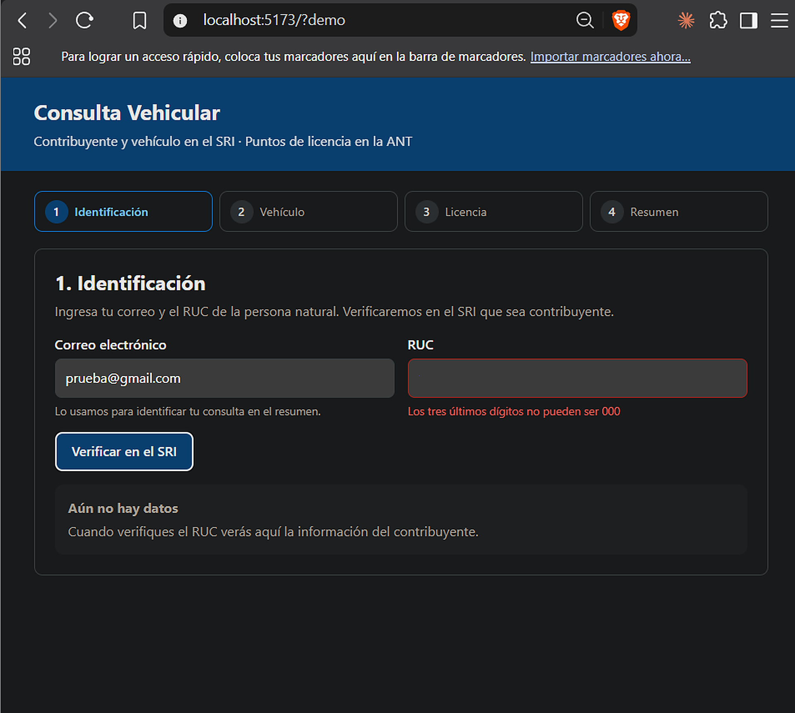

**CP-02 · RUC con formato inválido**

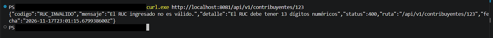

**CP-03 · RUC que no es persona natural**

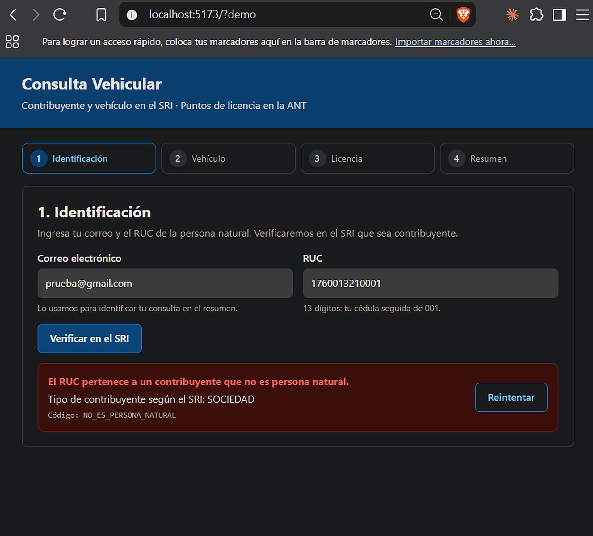

**CP-04 · RUC no registrado como contribuyente**

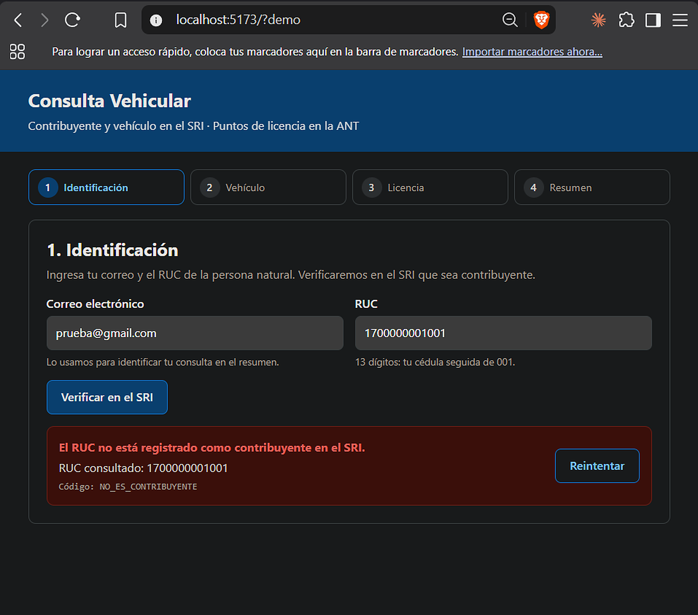

**CP-05 · Contribuyente persona natural**

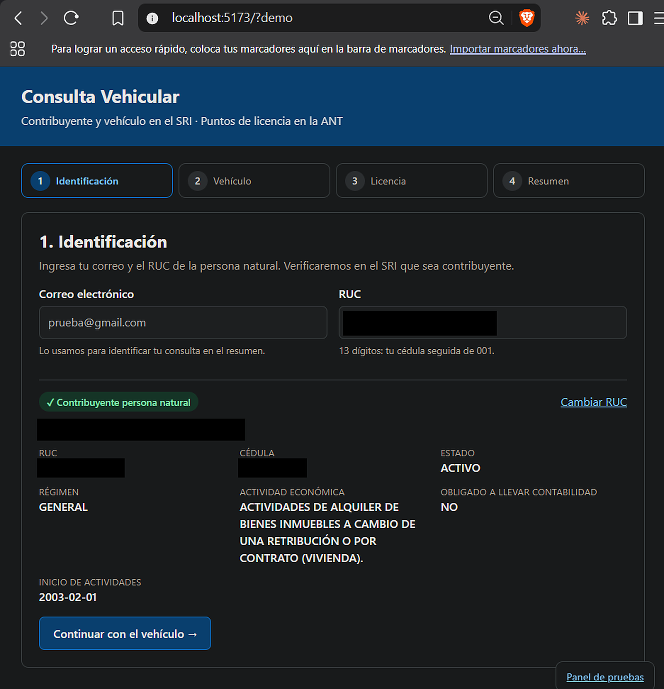

**CP-06 · Placa inválida**

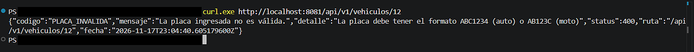

**CP-07a · Primera consulta: responde la ANT**

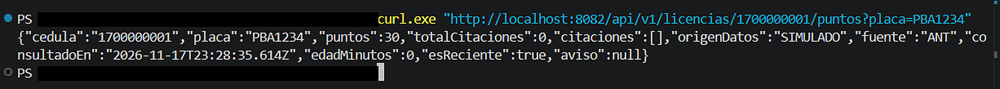

**CP-07b · Segunda consulta: responde la caché**

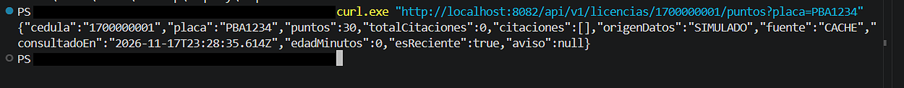

**CP-07c · ANT caída: se muestra el último dato guardado**

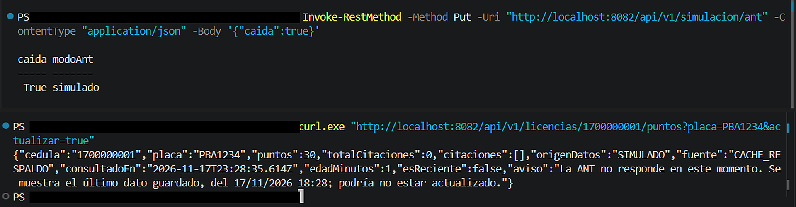

**CP-07d · ANT caída sin dato guardado**

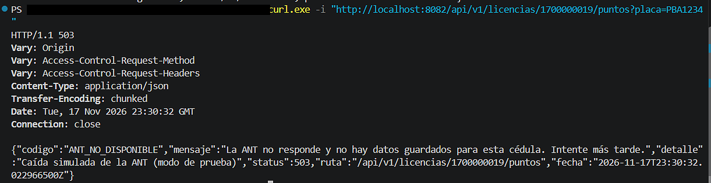

**CP-07e · ANT restablecida**

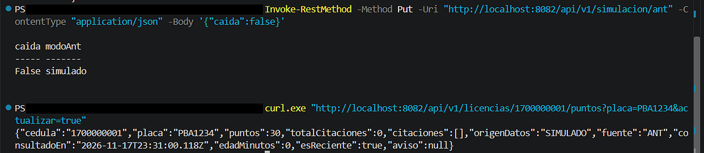

## Pruebas automáticas

```powershell
cd ms-sri;   .\mvnw.cmd test
cd ms-ant;   .\mvnw.cmd test
cd frontend; npm test
```

Cubren la validación de cédula, RUC y placa, la verificación de persona natural, la lectura de la respuesta de la ANT y todos los caminos de la caché.
